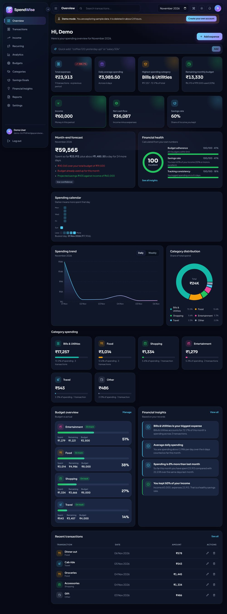
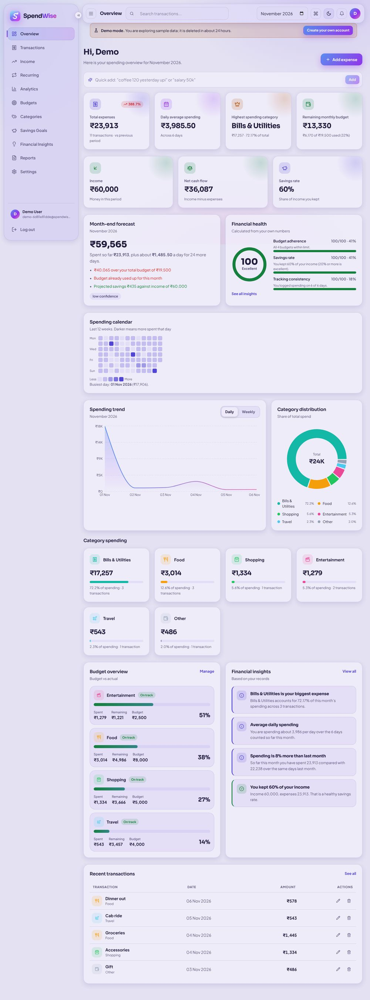
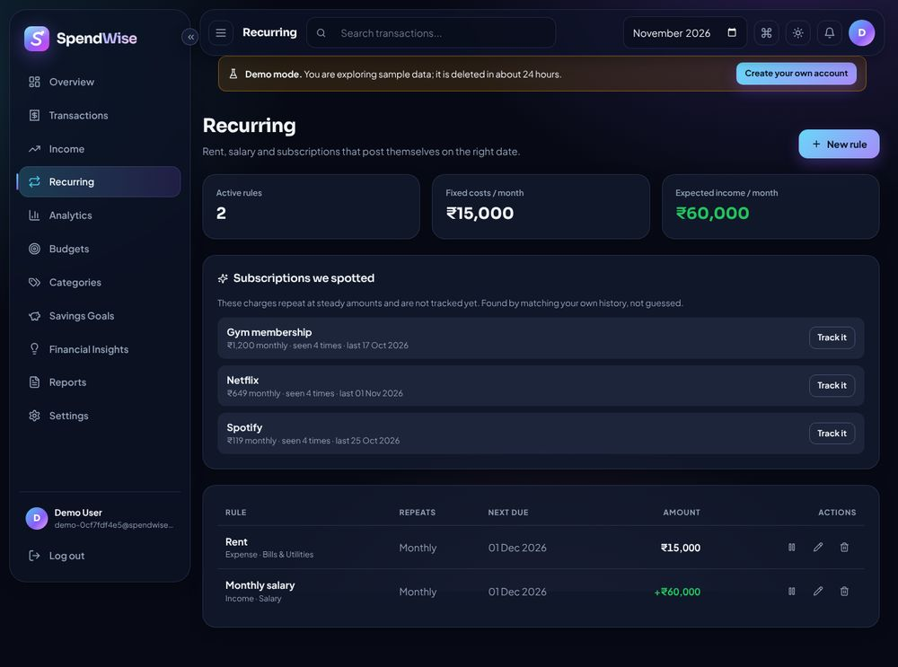
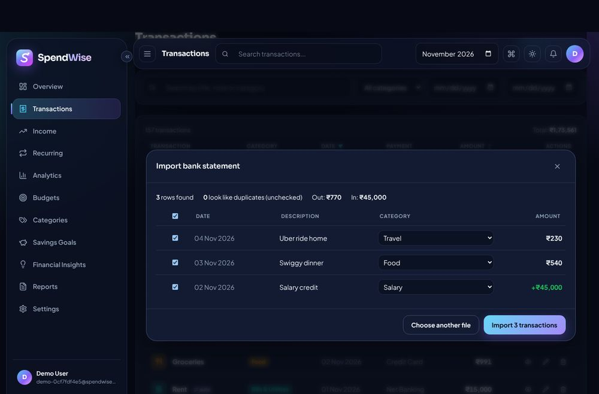
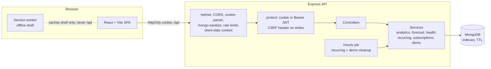

# SpendWise

**Understand your spending. Take control of your money.**

A personal finance app built with MongoDB, Express, React and Node: track expenses *and* income, automate
recurring bills, import bank statements, and see a forecast and a health score that explain themselves.
No AI buzzwords. Every number comes from a rule you can read in the code.



| Light theme | Recurring + detected subscriptions | CSV import |
| --- | --- | --- |
|  |  |  |

## Try it in 60 seconds

```bash
# put your MongoDB Atlas string in a .env file next to docker-compose.yml: MONGO_URI=mongodb+srv://...
docker compose up --build        # then open http://localhost:5000
```

Click **Try the live demo**. You get a private account with clearly labelled sample data (deleted after 24 hours).
Without Docker, see [Running locally](#running-locally).

## What it does

**Money tracking**
- Expenses and income with search, filters, sorting, pagination and validation
- Delete is a soft delete with an **Undo** button (records are kept for 30 days, then removed automatically)
- **Recurring rules** (weekly / monthly / yearly) for rent, salary and subscriptions. They post themselves on the due date, once, even with several servers running
- **Bank-statement CSV import**: detects the date format (dd/mm, mm/dd, ISO), debit/credit columns and header preambles, suggests a category from the description, flags duplicates, and shows a review screen before saving anything
- **Subscription detector**: finds charges that repeat at steady amounts and offers to track them

**Debts, loans and backup**
- **Debts & loans tracker**: record money you owe or lent, log repayments, see remaining balance, due dates and a net position
- **Backup & export** (Settings): download a full JSON backup or a CSV of all transactions

**Insight (all rule-based and explained on screen)**
- **Month-end forecast**: projects the month from your daily run-rate, excluding fixed bills and adding bills still due. Says "not enough data" instead of guessing, and shows a confidence level
- **Financial health score** (0-100): budget adherence 35%, savings rate 35%, spending stability 15%, tracking consistency 15%. Components are shown, missing data re-weights instead of faking a number
- Cash flow (income vs expenses), savings rate, spending **heatmap calendar**, category and trend charts
- Savings goals with a **suggested monthly contribution** to hit the target date
- Budgets with 80% / 100% alerts and a daily "safe to spend" figure

**Speed**
- **Quick add**: type `coffee 120 yesterday upi` or `salary 50k`. It is parsed by plain rules and opens in the normal form for you to confirm
- **Command palette** (Ctrl/Cmd + K) and shortcuts: `N` expense, `I` income, `Q` quick add, `/` search

**Quality**
- Light ("Lavender Mist") and dark ("Obsidian": black, silver and gold) themes, bundled fonts, installable as a PWA with an offline shell
- Lazy-loaded pages, skeleton loaders, error boundary, skip link, modal focus trap, keyboard-friendly, axe-core audit clean in both themes

## Architecture



```
SpendWise/
  client/    React + Vite (plain CSS design system, Recharts, Lucide, Axios, jsPDF loaded on demand)
  server/    Express + Mongoose
    models/ controllers/ routes/ middleware/ services/ utils/ tests/
  docs/      API.md, PITCH.md, screenshots
  Dockerfile  docker-compose.yml  render.yaml  .github/workflows/ci.yml
```

### Design decisions worth knowing

- **Auth** is an httpOnly, SameSite cookie, so XSS cannot read the session. Writes made with the cookie must also send `X-Requested-With: SpendWise`, which a cross-site form cannot do. Changing or resetting a password signs out every other session.
- **Ownership**: every read, update, delete and restore is scoped to the signed-in user (`utils/findOwned.js`, `userId` in every query and aggregation). The integration tests check this for every resource.
- **NoSQL injection**: request bodies, queries and params are stripped of `$` operators, and controllers coerce inputs to strings.
- **Rate limits**: login 10 / 15 min (failed attempts only), register, demo and password-reset limits, plus a global API limit.
- **"Today" is the user's today**: the client sends `X-Client-Date`, accepted only within 3 days of server time, so late-night entries and recurring runs land on the right day in any timezone.
- **Recurring rules are claimed atomically** (`updateOne({_id, nextDate: current}, {nextDate: next})`), so concurrent runs never double-post. This is tested.
- **Categories are referenced by name** (simple, readable data; renames and deletes cascade in code). The trade-off is that renaming touches many documents. At larger scale, reference an `_id` instead.
- **Currency is display-only.** Amounts are stored as entered, with no conversion.
- Aggregations use `$group` / `$dateToString` pipelines; MongoDB indexes cover `userId + date` access and a TTL index purges soft-deleted rows.

## Running locally

Requirements: Node 18+ and a free [MongoDB Atlas](https://www.mongodb.com/atlas) cluster (create a database user and add your IP under Network Access).

```bash
# API
cd server
npm install
cp .env.example .env     # set MONGO_URI and JWT_SECRET (node -e "console.log(require('crypto').randomBytes(48).toString('hex'))")
npm run dev

# Web (second terminal)
cd client
npm install
npm run dev              # http://localhost:5173, /api is proxied to :5000
```

Optional: `cd server && npm run seed` creates the fixed demo login `demo@spendwise.app` / `Demo@1234`.
The **Try the live demo** button needs no seed; it creates a throwaway account per visitor.

### Environment variables (`server/.env`)

| Variable | Purpose |
| --- | --- |
| `MONGO_URI` | MongoDB Atlas connection string (`mongodb+srv://...`) |
| `JWT_SECRET` | Long random secret for signing sessions (required) |
| `JWT_EXPIRES_IN` | Session lifetime, default `7d` |
| `CLIENT_URL` | Allowed web origin(s), comma separated. Also used in password-reset links |
| `COOKIE_SAMESITE` | `lax` (default, same-site). Use `none` only if the web app and API are on different domains (needs HTTPS) |
| `COOKIE_SECURE` | `true` in production (default). Set `false` only for plain-http localhost |
| `SERVE_CLIENT` | `true` to serve `client/dist` from the API (single host) |
| `SMTP_HOST`, `SMTP_PORT`, `SMTP_USER`, `SMTP_PASS`, `MAIL_FROM` | Password-reset email. Without `SMTP_HOST` the link is logged (and returned in development only) |

## Tests

```bash
cd server && npm test     # 22 unit tests + 27 API integration tests (spins up mongodb-memory-server)
cd client && npm test     # utility tests
```

Set `TEST_MONGO_URI` to use an existing MongoDB instead of downloading one. Integration tests cover cookie auth and
the CSRF header, ownership isolation across every resource, soft delete and restore, income and cash flow, budgets,
recurring catch-up and concurrent runs, CSV import, quick add, demo accounts, password reset, NoSQL injection, the
client-date rule and rate limiting. CI (`.github/workflows/ci.yml`) runs both suites and the client build.

## Deployment

- **One container** (simplest, cookies just work): `docker compose up --build`, or deploy the `Dockerfile` to any host.
  `render.yaml` is a ready Render blueprint; use MongoDB Atlas and set `MONGO_URI` and `CLIENT_URL`.
- **Split hosting**: API on a Node host, `client/` on Vercel/Netlify. `client/vercel.json` proxies `/api` to your API host
  (replace `YOUR-API-HOST`), which keeps the cookie same-site. Otherwise use `COOKIE_SAMESITE=none` over HTTPS.
- Production checklist: strong `JWT_SECRET`, Atlas IP allowlist, HTTPS, `NODE_ENV=production`, never commit `.env`.

## Documentation

- [`docs/API.md`](docs/API.md): every endpoint
- [`docs/PITCH.md`](docs/PITCH.md): a 3-minute demo script and talking points

## Known limits

- PDFs use ISO currency codes (`INR 1,200.00`) because jsPDF's built-in fonts cannot draw the rupee sign.
- Forecasts need at least 3 days and 3 transactions in the month, and are less reliable early in the month (the app labels this).
- The health score is a transparent heuristic, not financial advice.
- Bank CSV formats vary; the importer handles common layouts and always shows a review step, but a rare format may need a manual fix.
